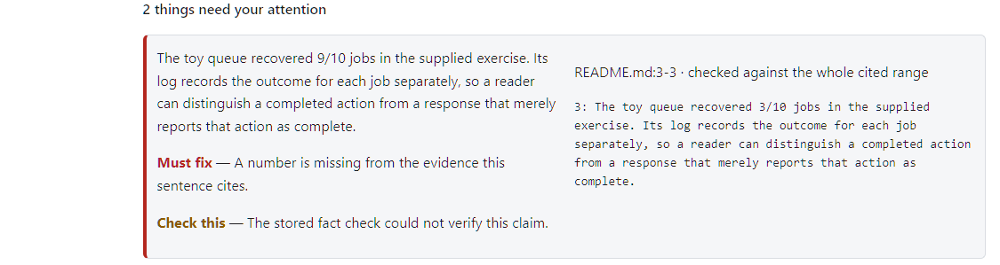

# Shipyap

[](https://github.com/devdiv07/shipyap/actions/workflows/ci.yml)
[](https://github.com/devdiv07/shipyap/releases/latest)
[](LICENSE)

**You ship. It yaps. With receipts.**



The demo's sample draft. Shipyap blocks a number the repo doesn't support.

Turn your GitHub work into LinkedIn (and X) posts you can back up: with repo citations, nothing
posted without your approval.

[Try the demo](#try-the-demo) · [Use your own repo](#use-your-own-repo) · [How it works](#how-it-works)

- **[Try it free](#try-the-demo)**: offline demo, no keys, no account.
- **[Use it on your repos](#use-your-own-repo)**: with an Anthropic API key (measured about
  $0.15 per draft, with weekly caps; [costs and limits](#costs-and-limits)), or with
  [your Claude plan and no API credits](#use-your-claude-plan-no-api-credits).

The demo is fictional, offline after installation, and needs no accounts or keys.

## What's new in 0.2

[Watch the demo video](https://github.com/devdiv07/shipyap/releases/download/v0.2.0/shipyap-demo.mp4)
· [Release notes](docs/releases/v0.2.0.md)

- **Catches code overclaims.** A sentence that says more than the cited code does (a runtime
  outcome the code doesn't show, or a value's meaning when other lines change it) has to be fixed
  before you can approve it.
- **Writes in your voice.** `voice = "dry-nerdy"` gives short posts shaped by your own style file,
  ending with your repo link. A joke line that slips in a fact is blocked.
- **Can use your Claude plan instead of API credits.** Set `provider = "claude-plan"`, and model
  calls go through Claude Code on your Pro or Max plan. [Setup](#use-your-claude-plan-no-api-credits).

## Try the demo

On Windows, install [uv](https://docs.astral.sh/uv/getting-started/installation/). You do not need
to install Python: the first `uv run --locked` reads `.python-version` and downloads Python 3.12 for
this project if it is missing. [Git](https://git-scm.com/downloads) is only needed to clone; a ZIP
download of the repository (Code, then Download ZIP on GitHub), extracted, works the same.
Open PowerShell where you keep projects, then clone the repository and open the
sample in your browser:

```powershell
git clone https://github.com/devdiv07/shipyap.git
cd shipyap
.\scripts\demo.ps1
```

If PowerShell blocks scripts on your machine, run `powershell -ExecutionPolicy Bypass -File .\scripts\demo.ps1` instead.

Or start it without opening a browser automatically; Ctrl+click the printed link:

```powershell
uv run --locked --no-dev shipyap demo
```

The first launch may download locked dependencies. Each launch creates a fresh temporary workspace.
The original sample says **9/10**, while its cited `README.md:3` says **3/10**. The Must fix card
shows both and disables Approve. Choose **Fix it and recheck** to apply the scripted 3/10
correction. The citation checks pass and Approve becomes available for the temporary sample.
Everything is labelled **SYNTHETIC SAMPLE DATA**. The example fact check is scripted, and the
edited sentence has no new model fact check. Demo scheduling is permanently disabled.
Ctrl+C stops the page and removes the workspace.

## Use your own repo

Start in the repository folder. Pick a new workspace and a public GitHub repository you own:

```powershell
uv run --locked --no-dev shipyap init --workspace 'C:\work\my-posts' --repo 'owner/repo'
```

Edit `C:\work\my-posts\pros.toml` to set your limits and, optionally, your own author statements
and posting slots. Without an author statement the draft uses third person.
The UTC offset defaults to your machine's current offset; `--utc-offset +05:30` overrides it.
Existing workspaces and files are preserved; for another repo use `shipyap repo set`.

Drafts and fact checks use **Anthropic's Claude API** by default. If you have a Claude Pro or Max
plan, you can skip the key and credits:
[use your Claude plan](#use-your-claude-plan-no-api-credits). To enable paid generation on the API on Windows:

1. [Create an API key in the Claude Console](https://platform.claude.com/docs/en/get-api-key).
2. [Add API usage credits](https://support.claude.com/en/articles/8977456-how-do-i-pay-for-my-claude-api-usage)
   in the Console's Billing settings.
3. In Windows, search for **Edit environment variables for your account**. Under **User variables**,
   choose **New**: name `PROS_ANTHROPIC_API_KEY`, value your API key. Save it there, not in a
   repository file or chat.
4. Open a new PowerShell terminal so it inherits the variable. If using VS Code's terminal, restart
   VS Code first. The demo needs no key.

For first-person drafts, append this minimal example to pros.toml, replacing it with your own true
statement and the repository you initialized:

```toml
[author]
name = "Your Name"

[[author.repos]]
repo = "owner/repo"
relationship = "primary_author"
statements = ["I built this tool to keep my project notes in one place."]
```

Statements are your recorded personal experience and intent. Personal first-person claims must
come from them; the tool must not invent your involvement or motivation. Repository facts still
need evidence. Then explicitly start a paid run and open review:

```powershell
uv run --locked --no-dev shipyap run --config 'C:\work\my-posts\pros.toml' --allow-paid
.\scripts\review.ps1 -Config 'C:\work\my-posts\pros.toml'
```

If PowerShell blocks scripts, run `powershell -ExecutionPolicy Bypass -File .\scripts\review.ps1 -Config 'C:\work\my-posts\pros.toml'` instead.

Read each post and its evidence before approving. Approval binds the exact text, destination and
time. Scheduling is a separate confirmation. For optional publishing to LinkedIn and X, follow
[Buffer setup](docs/buffer.md). No post is sent without you.

## How it works

1. Read a public repository and save a pinned evidence snapshot.
2. Find candidate stories and draft one with a model, within the configured budget.
3. Check citations and claims, and run a second-model fact check; show the results for review.
4. You read, edit, approve or reject. If configured, you separately confirm scheduling.

Checks and model judgments are aids, not proof. If a draft's fact check does not complete, it cannot
be approved. A completed check can still miss mistakes; read the source yourself.

## Costs and limits

Measured usage has been about **$0.15–$0.20 per draft at list price** (draft plus fact check
about $0.14 in the latest trial). Costs vary with the model,
repository size and discovery work, and provider prices or billing can differ. `max_cost_usd` is
the estimated reservation ceiling for each run (the default `'1.00'` covers discovery, one draft
and its fact check); `weekly_draft_cap` limits draft attempts per week. A run that would go over
it makes no call and says to raise `max_cost_usd` in `pros.toml`.
Reservations are estimates, not provider billing guarantees. Set a provider-side spending limit too.
If drafting fails with a usage-limit message, raise the monthly limit in the Anthropic Console.

## Use your Claude plan (no API credits)

If you pay for a Claude subscription (Pro or Max), Shipyap can send its model calls through
[Claude Code](https://docs.claude.com/en/docs/claude-code) on your computer instead of the
Anthropic API. These calls use your plan's normal usage, not API credits, and you need no API key.
The prompts, checks, fact check, repair and review page are exactly the same as on the API.
Tested on Windows.

You need: a Claude Pro or Max plan, Claude Code installed, and a workspace from
[Use your own repo](#use-your-own-repo) (skip the API key steps there).

1. Install Claude Code, open PowerShell and run `claude` once. Sign in with your Claude account
   (not an API key), then type `/exit`. Do not set `ANTHROPIC_API_KEY` for Claude Code.
2. Check the setup. This makes **one** tiny call through your plan and prints what it found:

   ```powershell
   powershell -ExecutionPolicy Bypass -File .\scripts\model-plan.ps1 -Doctor -Config 'C:\work\my-posts\pros.toml'
   ```

   It must end with `Doctor: PASS`. It refuses if Claude Code uses an API key or an
   `apiKeyHelper`, if the flags are not accepted, or if anything besides Shipyap's prompt
   reached the model.
3. Add these lines to `pros.toml` (above any `[author]` table):

   ```toml
   provider = "claude-plan"
   plan_calls_per_day = 8        # model calls per day on your clock; a draft takes about 3 to 5
   # plan_window = "01:00-06:00" # optional: only call the model at these hours (your clock)
   ```

4. Run it with the wrapper, which repeats until the draft is finished:

   ```powershell
   powershell -ExecutionPolicy Bypass -File .\scripts\run-and-notify.ps1 -Config 'C:\work\my-posts\pros.toml'
   ```

5. Optional, the timer (every 3 hours while you are logged in to Windows). Run it **without**
   `-EnablePaid`; the plan route refuses that flag:

   ```powershell
   powershell -ExecutionPolicy Bypass -File .\scripts\setup.ps1 -Config 'C:\work\my-posts\pros.toml'
   ```

   The task runs as you, so it uses your own Claude Code sign-in.

To check what Shipyap reads from your config, run `uv run --locked --no-dev shipyap settings --config 'C:\work\my-posts\pros.toml'`.

How it works: `pros run` writes each model request to `model-outbox\` and stops with
`NEEDS_MODEL` (exit code 3). `scripts\model-plan.ps1` runs `claude -p` once per request in a fresh,
empty folder with every tool, plugin, hook, MCP server, skill, `CLAUDE.md` and user setting turned
off, and saves the raw answer in `model-inbox\`. `pros run --resume` then continues exactly as
with an API reply. A fact check or repair can take more rounds; the wrapper loops until done.
Every answer stays in `model-inbox\`, so `pros eval` can replay it.

If something goes wrong:

- **Not signed in or sign-in expired:** one notification, "Sign in to Claude Code (run `claude`
  once)". Nothing is sent until you sign in; the next run continues by itself.
- **Plan usage limit reached:** one notification. Nothing is sent until the limit resets (or run
  `pros run --config ... --retry-now`).
- **No answer in time** (`plan_timeout_seconds`, default 300): the request is asked again on the
  next run. Every call counts toward `plan_calls_per_day`.
- **Unusable answer:** it is kept and refused by the same checks as a bad API reply.

`provider = "chatgpt-plan"` is reserved for a later version and is refused for now.

## Scope and limitations

Windows is the first target; Linux is tested in CI; macOS is untested. The timer is Windows-only.

Works best on repositories with written records such as design notes, experiment logs and
changelogs. Code-only repos produce drafts that need correction. Public GitHub access is rate
limited; the selected snapshot may not include everything that matters. The fact check cannot
guarantee accuracy, and a human still needs to read every claim and source. The optional recurring
timer uses Windows Task Scheduler and runs only while the user is logged in.

The default voice is plain. `voice = "dry-nerdy"` with your style file gets closer to how you
write, but check every claim before approving.

## Safety and the timer

The application never approves a post for you. Scheduling is off by default and requires your
separate confirmation. Create a file named `STOP` in the workspace to pause runs, approval and
scheduling; remove it to resume. STOP does not cancel anything already submitted to Buffer.

The timer uses the normal application environment, not the development tools. To enable it:

```powershell
uv sync --locked --no-dev
.\scripts\setup.ps1 -Config 'C:\work\my-posts\pros.toml' -EnablePaid
```

If PowerShell blocks scripts, run `powershell -ExecutionPolicy Bypass -File .\scripts\setup.ps1 -Config 'C:\work\my-posts\pros.toml' -EnablePaid` instead.

Omit `-EnablePaid` for free runs, and always omit it with `provider = "claude-plan"`. When a draft is ready, the notification says how many drafts
are waiting and has a **Review** button that opens that draft on the review page. If the page is
already open, the button reuses it. Setup registers a `shipyap://` link handler for your Windows
user only. Remove the timer and the handler with `.\scripts\setup.ps1 -Remove`
(or `powershell -ExecutionPolicy Bypass -File .\scripts\setup.ps1 -Remove`).

## Ask an AI to help set up

Copy this into your assistant, replacing the placeholders:

```text
Help me set up Shipyap on Windows. Use a new workspace at <workspace path> and my public
repository <owner/repo>. Run uv run --locked --no-dev shipyap init --workspace <workspace path>
--repo <owner/repo>. Explain the generated pros.toml and its cost caps. Do not ask for, print, save,
or use my API keys. Do not run paid calls, approve, schedule, or publish anything for me.
```

## Troubleshooting

- **No browser opens:** Ctrl+click the URL printed in the terminal. Keep that terminal open.
- **No draft:** Read the run report for budget, rate-limit, evidence or no-story messages.
- **Cannot approve:** Review flagged sentences and confirm the fact check completed; edit and
  revalidate as needed. A completed fact check is not a guarantee that the text is correct.
- **Scheduling is unavailable:** Follow [Buffer setup](docs/buffer.md), then restart review.
  Approval and scheduling are separate actions.
- **Existing workspace error:** Check that its stores are readable and use `shipyap repo set` to add a
  new repo. Initialization does not overwrite an existing workspace.

`shipyap` is the command; `pros` remains as an alias. The Python package is `shipyap`.

See [CONTRIBUTING.md](CONTRIBUTING.md) and [SECURITY.md](SECURITY.md).
